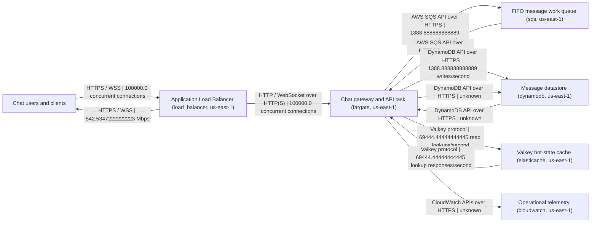

# Architecture design

## Diagram

## Components and actors

- **Chat users and clients** (external\; node ID\: chat\-users): External clients in the required us\-east\-1 deployment scope\; clients establish WebSocket connections and issue text\-message and read requests\.
- **Application Load Balancer** (component\; node ID\: chat\-websocket\-alb\-us\-east\-1\; component ID\: chat\-websocket\-alb\-us\-east\-1\; load\_balancer\; us\-east\-1): Selected application load balancer for HTTP requests and WebSocket upgrades\. The selected configuration specifies one load balancer\, not an AZ count\.
- **Chat gateway and API task** (component\; node ID\: chat\-gateway\-us\-east\-1\; component ID\: chat\-gateway\-us\-east\-1\; fargate\; us\-east\-1): Selected single Linux ARM64 Fargate task \(2 vCPU\, 4 GB\) hosting the gateway\/API\. It is also shown as the queue consumer because no separate worker component was selected\.
- **FIFO message work queue** (component\; node ID\: chat\-message\-work\-queue\-us\-east\-1\; component ID\: chat\-message\-work\-queue\-us\-east\-1\; sqs\; us\-east\-1): Selected SQS FIFO queue\, intended to decouple accepted messages from processing and to use conversation identifiers for ordering\.
- **Message datastore** (component\; node ID\: chat\-messages\-us\-east\-1\; component ID\: chat\-messages\-us\-east\-1\; dynamodb\; us\-east\-1): Selected on\-demand\, standard\-class DynamoDB component in us\-east\-1\. No replica or global\-table configuration is selected\.
- **Valkey hot\-state cache** (component\; node ID\: chat\-hot\-state\-us\-east\-1\; component ID\: chat\-hot\-state\-us\-east\-1\; elasticache\; us\-east\-1): Selected ElastiCache Valkey component with two cache\.r7g\.8xlarge nodes\. The selection describes a replica\-backed foundation but does not specify sharding\, node roles\, or AZ placement\.
- **Operational telemetry** (component\; node ID\: chat\-observability\-us\-east\-1\; component ID\: chat\-observability\-us\-east\-1\; cloudwatch\; us\-east\-1): Selected CloudWatch component for logs\, metrics\, and alarms\; its billable usage is not estimated in the supplied cost results\.

## Data flows

- **users\-to\-alb**: chat\-users → chat\-websocket\-alb\-us\-east\-1; protocol: HTTPS \/ WSS; expected volume: 100000\.0 concurrent connections.
  - Purpose: Client HTTP requests and WebSocket connection upgrades enter through the load balancer\.
  - Volume explanation: The estimate is the specified concurrent connection requirement\; request rate on this edge is not supplied\.
  - Basis: Uses the supplied concurrent connection sizing metric\; this is a concurrency target\, not a request\-rate estimate\.
  - Capacity metrics: concurrent\_connections
- **alb\-to\-gateway**: chat\-websocket\-alb\-us\-east\-1 → chat\-gateway\-us\-east\-1; protocol: HTTP \/ WebSocket over HTTP\(S\); expected volume: 100000\.0 concurrent connections.
  - Purpose: The load balancer forwards requests and upgraded persistent connections to the selected gateway task\.
  - Volume explanation: Uses the supplied concurrent connection metric\, not an assertion that the single selected task has been demonstrated to support it\.
  - Basis: Assumes the client connection target is forwarded to the gateway\; no connection distribution or task scaling is modeled\.
  - Capacity metrics: concurrent\_connections
- **alb\-to\-users\-egress**: chat\-websocket\-alb\-us\-east\-1 → chat\-users; protocol: HTTPS \/ WSS; expected volume: 542\.5347222222223 Mbps.
  - Purpose: Outbound responses and message delivery traffic from the service to clients\.
  - Volume explanation: The supplied egress\_bandwidth value is used as the estimated peak outbound bandwidth\; no per\-client or per\-message distribution is provided\.
  - Basis: Uses the supplied peak egress bandwidth estimate derived from peak\_read\_qps and average response size\; it is an estimate\, not a measured traffic split\.
  - Capacity metrics: egress\_bandwidth
- **gateway\-to\-queue**: chat\-gateway\-us\-east\-1 → chat\-message\-work\-queue\-us\-east\-1; protocol: AWS SQS API over HTTPS; expected volume: 1388\.888888888889 messages\/second.
  - Purpose: The gateway enqueues accepted text\-message work\; conversation identifiers are assumed to be used as FIFO message group identifiers\.
  - Volume explanation: This is an assumption\-based peak enqueue rate using the capacity metric peak\_write\_qps\, not observed queue throughput\.
  - Basis: Assumes one queue message for each modeled peak application write\, matching the supplied peak\_write\_qps\; retries\, batching\, and fan\-out are excluded\.
  - Capacity metrics: peak\_write\_qps
- **queue\-to\-gateway\-worker**: chat\-message\-work\-queue\-us\-east\-1 → chat\-gateway\-us\-east\-1; protocol: AWS SQS API over HTTPS; expected volume: unknown.
  - Purpose: The gateway task polls and consumes queued message work as the worker role\; no separately selected consumer service exists\.
  - Volume explanation: No polling\, batching\, retry\, or consumer throughput configuration is supplied\, so a defensible queue delivery call rate cannot be calculated\.
- **gateway\-to\-dynamodb\-write**: chat\-gateway\-us\-east\-1 → chat\-messages\-us\-east\-1; protocol: DynamoDB API over HTTPS; expected volume: 1388\.888888888889 writes\/second.
  - Purpose: The queue\-processing role persists accepted message records to the message datastore\.
  - Volume explanation: The peak write rate is from the supplied sizing metric\. Actual datastore rate may differ with batching\, retries\, delivery work\, or queue backlog\.
  - Basis: Uses peak\_write\_qps as the modeled persistence rate\, assuming one single\-item datastore write per accepted message and steady processing without backlog\.
  - Capacity metrics: peak\_write\_qps
- **gateway\-to\-cache\-read**: chat\-gateway\-us\-east\-1 → chat\-hot\-state\-us\-east\-1; protocol: Valkey protocol; expected volume: 69444\.44444444445 read lookups\/second.
  - Purpose: The gateway consults the cache for hot message data and session\/connection state on the read path\.
  - Volume explanation: This represents assumed cache lookups at the supplied peak\_read\_qps\, not a measured cache request rate\.
  - Basis: Assumes each modeled peak application read consults the cache once\; no cache hit rate is assumed\.
  - Capacity metrics: peak\_read\_qps
- **cache\-to\-gateway\-response**: chat\-hot\-state\-us\-east\-1 → chat\-gateway\-us\-east\-1; protocol: Valkey protocol; expected volume: 69444\.44444444445 lookup responses\/second.
  - Purpose: Returns cached read results and state to the gateway where present\.
  - Volume explanation: Response rate follows the assumed one\-lookup\-per\-read pattern\; cache hits and misses are not quantified\.
  - Basis: Assumes one cache lookup response per peak application read\; does not imply all responses are cache hits\.
  - Capacity metrics: peak\_read\_qps
- **gateway\-to\-dynamodb\-read**: chat\-gateway\-us\-east\-1 → chat\-messages\-us\-east\-1; protocol: DynamoDB API over HTTPS; expected volume: unknown.
  - Purpose: The gateway retrieves message records from DynamoDB when required by the read path\, including cache misses\.
  - Volume explanation: The peak application read rate is known\, but cache hit rate and cache\-miss behavior are not\. Therefore DynamoDB read QPS cannot be defensibly derived\.
- **dynamodb\-to\-gateway\-read\-result**: chat\-messages\-us\-east\-1 → chat\-gateway\-us\-east\-1; protocol: DynamoDB API over HTTPS; expected volume: unknown.
  - Purpose: Returns requested message records to the gateway for responses or delivery when a datastore read occurs\.
  - Volume explanation: Datastore read volume depends on the unspecified cache hit rate and read behavior\.
- **gateway\-to\-cloudwatch**: chat\-gateway\-us\-east\-1 → chat\-observability\-us\-east\-1; protocol: CloudWatch APIs over HTTPS; expected volume: unknown.
  - Purpose: Publishes operational logs and metrics such as connection counts\, throughput\, errors\, and delivery latency\.
  - Volume explanation: No log volume\, metric cardinality\, sampling\, or publication frequency is supplied\; the cost estimate also leaves CloudWatch usage unpriced\.

## Architecture decisions

- **Read path:** Clients connect through the ALB to the Fargate gateway\. The gateway is modeled as consulting Valkey for hot data\/state and retrieving from DynamoDB when needed\. Cache placement is between gateway and datastore\; cache hit rate is unknown\, so DynamoDB read traffic is not estimated\. The supplied peak\_read\_qps is used only as an assumed cache lookup rate\, not as a measured cache\-hit rate\.
- **Write path:** The modeled path is client \-&#62; ALB \-&#62; gateway \-&#62; SQS FIFO \-&#62; gateway task acting as consumer \-&#62; DynamoDB\. Queue decoupling and per\-conversation FIFO ordering are selected\; there is no separate worker component\. The peak enqueue and persistence estimates assume one queue message and one datastore write per application write\, with no backlog\, retry\, or fan\-out\.
- **Availability zones:** Unknown\/not specified by the selected component and cost data\. No AZ count or multi\-AZ deployment is claimed\. The two ElastiCache nodes do not by themselves establish AZ placement or a fully specified failover design\.
- **Datastore failover:** DynamoDB is the selected regional on\-demand datastore\, but no replica\, global table\, or explicit failover configuration is selected\. A primary\/replica failover path therefore does not apply as a configured topology here\; do not infer cross\-region failover or a particular recovery objective\.

## Tradeoffs and risks

- The selected Fargate gateway count is one task \(2 vCPU\, 4 GB\)\, while the sizing includes 100\,000 concurrent connections\, 69\,444 peak reads\/second\, and 1\,389 peak writes\/second\. The selection does not establish that this task can meet those demands\, nor does it specify scaling or redundancy\; additional capacity and its cost may be required\.
- The Valkey selection has two large\-memory nodes and cites an approximately 114 GB hot working set\, but usable memory\, node roles\, sharding\, cache policy\, and AZ placement are unspecified\. The two\-node choice is not proof that the entire working set fits or that the requested workload is supported\.
- DynamoDB on\-demand is selected\, but partition\-key design and hot\-partition behavior remain workload\-dependent\. The capacity\-cost model assumes average rates at 10\% of peak and one single\-item operation per application operation\; it is not a measured peak bill or a complete database cost\.
- The FIFO queue adds decoupling but the only selected consumer is the same Fargate component\. Queue throughput\, polling\/batching\, backlog limits\, retry and dead\-letter handling are unspecified\; FIFO ordering can constrain per\-group throughput\.
- The cost estimate is explicitly incomplete\. It reports known monthly cost of USD 1\,939\.0625 but excludes Fargate\, ALB\, ElastiCache\, SQS\, CloudWatch\, and several DynamoDB\-related charges\. It is not a complete budget\; the clarification says budget is unrestricted\, not that these costs are covered\.
- The supplied annual storage growth estimate is substantial\, but retention\, deletion\, archival\, backups\, and storage\/index growth assumptions are not specified or fully priced\.
- The supplied egress estimate is used as a directional capacity estimate only\; actual traffic distribution\, message fan\-out\, delivery retries\, and client behavior are not supplied\.

## Assumptions

- A client read traverses the gateway and consults Valkey once\; no cache hit ratio is assumed\.
- Each modeled accepted write is enqueued once and results in one single\-item DynamoDB write\; retries\, batching\, and fan\-out are excluded from the estimate\.
- The selected gateway component performs both API\/gateway duties and queue consumption\; no unselected worker service is introduced\.
- The estimated outbound bandwidth corresponds to the supplied egress\_bandwidth capacity metric\; no traffic split by protocol or client is inferred\.
- No data\_transfer cost entry is present in the supplied cost estimate\, so no accounting node is added\.
- No AZ placement\, autoscaling policy\, datastore replication configuration\, or cross\-region deployment is inferred beyond the supplied selected component details\.
